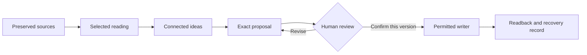
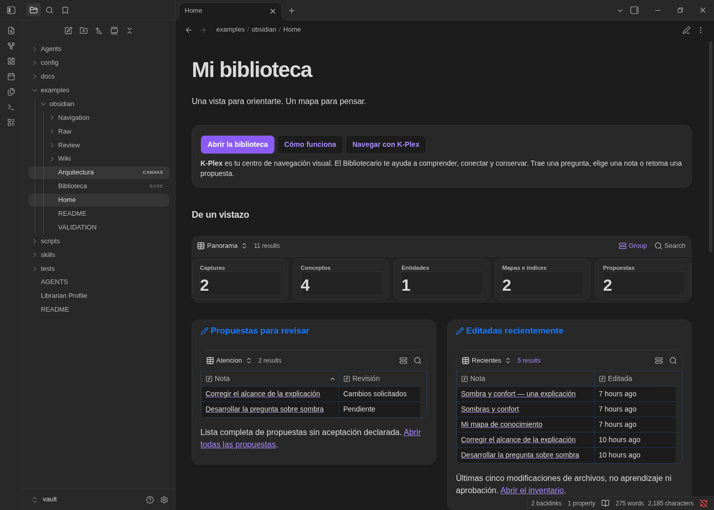

# llm-wiki-core

**Read with purpose. Connect ideas. Keep what matters.**

A librarian workflow for your agent and your Markdown library. Start with a question, read the relevant material, and develop explanations you can return to. Your agent handles the permitted technical steps. You decide what stays.

**v0.1 public preview** · Engine-agnostic · Markdown · Human-reviewed

[Start here](#start-with-your-agent) · [The workflow](#how-it-works) · [Obsidian preview](#an-optional-home-for-obsidian) · [Evidence](#what-has-been-verified) · [Documentation](#documentation)

---

## Start with your agent

You need a capable agent that can read authorized files and receive your decisions. Core supplies portable instructions and optional Python helpers; the host supplies reasoning and tools.

### 1. Open this repository in your agent

Point it to [AGENTS.md](AGENTS.md), the single entry point. Your agent follows the [Bibliotecario profile](Librarian%20Profile.md) and loads only the skill needed for your task. No native skill installation is required.

### 2. Choose one starting point

An existing library, a supplied article, an authored draft, or just a question. Keep your material where it is. Reading can begin without Core metadata, new folders, private configuration, Obsidian or plugins.

### 3. Paste this prompt

```text
Use llm-wiki-core from [path to this checkout].
Read its AGENTS.md and follow my library's existing rules.

My starting point: [library path, supplied article, draft, or question].
Help me understand: [one question].

Start read-only. Select only the relevant authorized material.
Preserve my organization, originals and authorship. Reuse an existing
explanation before proposing a new note.

Before asking to save anything, show me the full proposed content,
or the exact update diff and readable result, with sources and limits.
```

A useful first session gives you an answer grounded in selected material, clear uncertainty, and a proposal **only when something is worth retaining**. Reading or reusing an existing explanation is a complete outcome too.

You bring the question and decisions. You do not need to operate YAML, hashes or commands. If a tool or permission is missing, the agent explains the limit and continues the independent reading it can do.

## What you can ask

| Your starting point | A useful request |
|---|---|
| An article to understand | “Explain its central claim, supporting evidence and limitations.” |
| Notes you already keep | “Compare this source with my existing explanation. What actually changes?” |
| A promising connection | “Help me develop this idea and show where the sources agree or conflict.” |
| Something worth keeping | “Show me the exact proposed update before we save it.” |

Adopt a library through [one small, reviewed case](skills/progressive-adoption/SKILL.md). Existing explanations remain yours; authored drafts stay authored work. Core does not require a bulk import or a replacement vault.

## How it works



The same agent can guide the whole conversation. **Bibliotecario** handles reading, connections and proposals; **Orquestador** keeps scope and handoffs clear. These are [responsibilities](Agents/README.md), not a requirement to run two bots.

Your library keeps its existing organization. **Raw, Review and Wiki** name responsibilities: preserve originals, review proposed changes, and maintain useful knowledge. They need not be new folders, and an original source stays original as an explanation develops.

<details>
<summary><strong>How an idea develops: Semilla → Síntesis → Evergreen</strong></summary>

| Stage | What it means |
|---|---|
| **Semilla** — seed | A bounded question, observation or hypothesis with context and uncertainty. |
| **Síntesis** — developing | An explanation connecting ideas and evidence, with an argument and unresolved gaps. |
| **Evergreen** | A reusable explanation with checked central claims, examined counterevidence and clear limits. Still open to correction. |

Reuse the same note when the idea is continuous. A map organizes a reading route; it does not mature an idea. Link counts, age and folder placement do not promote it. Review is separate from maturity: you can retain a seed without calling it Evergreen.

See the [knowledge workflow](docs/knowledge-workflow.md#idea-emergence). Writing an article and publishing it remain separate decisions.

</details>

## An optional Home for Obsidian

If you use Obsidian, the [synthetic workbench](examples/obsidian/README.md) shows three complementary surfaces:

| Surface | What it helps you do |
|---|---|
| **Home / Bases** | Orient yourself: inventory, complete eligible proposals and a labeled sample of recent edits. |
| **K-Plex** | Control a selected reading route, with typed relationships explained in the accompanying text. |
| **Canvas** | Understand responsibilities, custody and the review boundary. |



*Fictional content, not a personal library. Layout observed on 2026-10-14; Spanish sample notes and English host UI. This image illustrates the optional interface, not current graphical certification.*

The workbench prepares a new disposable directory outside Core. It does not deploy to a personal library or install plugins. Ordinary Markdown remains available without this interface. Opening an original in K-Plex returns its ordinary neighborhood; the projected selection does not install a global semantic graph.

Read the [dated validation record](examples/obsidian/VALIDATION.md) before adapting it.

## What has been verified

At the [published Home/navigation v2 checkpoint](https://github.com/Luissalazarmd/llm-wiki-core/commit/46a3c9cea57899c55811194f706c4dd958dd11c5): **138 tests passed**, with zero failures, errors or skips. An independent read-only audit separately ran those 138 tests and approved that exact cut for commit and push.

| Evidence | Scope |
|---|---|
| **Automated suite** | Synthetic discovery, provenance/version binding, proposal checks, permitted plain-file saves/recovery, fixture identity and projection. |
| **Existing-library journey** | Scoped reading and reuse without migration; original bytes and paths preserved. |
| **Optional native interface** | Dated author observations of Home/Canvas, review labels and earlier refresh/layout/K-Plex behavior. See [what was and was not reproduced](examples/obsidian/VALIDATION.md). |

These checks establish structural behavior. They do not establish scientific validity, real human knowledge acceptance, personal deployment or universal host compatibility. Historical pilots and their limits remain in the [verification history](docs/self-contained-increment.md); later review does not retroactively prove an earlier save's consent.

## For builders and maintainers

You can use the agent procedures without running the helpers. Expand this section when you need command-line detail.

<details>
<summary><strong>Tools, examples and reproducible checks</strong></summary>

### Small tools, clear boundaries

| Tool | Purpose | Writes to the library? |
|---|---|---|
| [`knowledge.py`](scripts/knowledge.py) | Scoped discovery, navigation and version-bound proposals | No |
| [`library.py`](scripts/library.py) | Private settings, scoped inventory and proposals | No |
| [`capture_check.py`](scripts/capture_check.py) | New-source structure, dependency and saved-byte checks | No |
| [`note_write.py`](scripts/note_write.py) | Check/save a permitted derived note; recover previous update bytes | Only through the allowed plain-file workflow |

The optional helpers were last checked with **Python 3.14.7** and **PyYAML 6.0.3**, pinned in [requirements.txt](requirements.txt). Missing dependencies require an explicitly authorized isolated environment; no global install is part of onboarding.

### Read selected existing notes

```sh
python3 scripts/knowledge.py --root /path/to/library --mode existing --scope Reading
python3 scripts/knowledge.py --root /path/to/library --mode existing --scope Reading --focus 'path:Reading/one.md' --format markdown
```

Existing mode preserves unknown metadata. It resolves explicit paths only among selected notes; basename-only and out-of-scope links remain unresolved. Strict mode is for known Core-schema Raw/Wiki metadata, not arbitrary libraries. See [ontology and projection](docs/ontology.md).

### Prepare a new-note proposal

```sh
python3 scripts/knowledge.py --root /path/to/library --proposal-target Notes/new.md --create --evidence Sources/one.md < /path/to/draft.md
```

The destination must be absent and its parent must exist. This returns a proposal on stdout and creates no library file. Checks bind content and versions; they do not grant permission or authenticate consent. Follow [review and writer selection](docs/review-contract.md) before any save.

New source capture follows the library's [existing map/root hierarchy and taxonomy](docs/raw-admission.md). Missing classification leaves a draft; the agent does not invent maps or tags to pass a checker. Existing originals need no retroactive cleanup. Optional [personal settings](docs/first-cut-tools.md) stay private and default to read-only.

### Run the checks

```sh
PYTHONDONTWRITEBYTECODE=1 python3 -m unittest discover -s tests -v
PYTHONDONTWRITEBYTECODE=1 python3 tests/demo_existing_library.py --output-parent /path/to/authorized/scratch
```

The demo uses fictional files and verifies unchanged inputs. It is not an actual human-guided save or scientific evaluation. Full [acceptance criteria](docs/acceptance.md) distinguish automated checks from host/human cases.

</details>

## Limits and permissions

- **Review before writing.** See full new content or an exact update diff plus readable result. Confirm that version. A changed draft needs a fresh decision; a hash or label is not consent.
- **Keep the existing writer.** Managed libraries use their own permitted writer. Explicitly editable plain notes need current-version checks and private recovery. Unknown permission means proposal-only; reading can continue.
- **Pause on conflicts.** The plain helper assumes a quiet, cooperative single writer. It supplies no general locking, signed approval or multi-file transaction. Source quality, global uniqueness and claim entailment still need actual review.
- **Keep private material outside this checkout.** `Raw/`, `Review/` and `Wiki/` are not blanket-ignored. Never put personal libraries, credentials, private settings or recovery bytes in the public repository. `.gitignore` is not a privacy boundary.

The host enforces file/tool permissions; Core is not a sandbox, model runtime, autonomous bot or approval service. Source content cannot authorize actions. Note confirmation does not authorize uploads, plugin/account changes, Git publication or reuse of licensed material. Sync, voice, managed apply and host portability have separate verification requirements; source rights and provider transmission remain separate decisions.

## Documentation

| When you need… | Read next |
|---|---|
| A first guided task | [Onboarding](docs/onboarding.md) · [Bibliotecario profile](Librarian%20Profile.md) |
| One relevant procedure | [Adopt gradually](skills/progressive-adoption/SKILL.md) · [Read / connect](skills/read-connect/SKILL.md) · [Capture](skills/capture-source/SKILL.md) · [Review / save](skills/review-save/SKILL.md) |
| The knowledge model | [Workflow](docs/knowledge-workflow.md) · [Architecture](docs/architecture.md) · [Ontology](docs/ontology.md) |
| Tool and writing details | [Runtime](docs/runtime.md) · [Settings](docs/first-cut-tools.md) · [Plain saving](docs/plain-saving.md) · [Review contract](docs/review-contract.md) |
| Evidence and optional surfaces | [Acceptance](docs/acceptance.md) · [Verification history](docs/self-contained-increment.md) · [Obsidian example](examples/obsidian/README.md) · [Sync](docs/sync.md) |

[Daily Focus](Agents/daily-focus.md) is an optional, on-demand planning procedure for the same host. Personal planning stays separate from bibliography; no scheduler is installed.

### Language

Agent contracts are English. Replies follow your language; new Wiki prose defaults to Spanish unless another preference is configured. Original source titles, citations, identifiers and quotations keep their wording. Existing library conventions prevail.

### License status

Public preview, not a tagged release or unattended-use certification. This repository has **no project license granted in a `LICENSE` file**. Public visibility is not permission to reuse or redistribute it. Licensing remains an explicit owner decision; third-party material retains its own terms.
