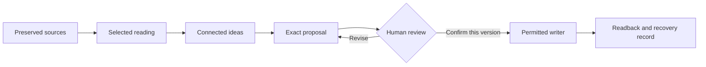

# llm-wiki-core

### A librarian workflow for your agent and your Markdown library

Read selected sources, develop connected ideas, review exact changes, and retain useful knowledge. Your agent does the reasoning. You decide what stays. Your files remain in your library.

**v0.1 · Public preview · Markdown · Agent-guided · 138 passing tests**

[Start](#start-with-your-agent) · [Workflow](#how-it-works) · [Tools](#small-tools-clear-boundaries) · [Verification](#what-has-been-verified) · [Limits](#limits-and-permissions)

> Core is a set of portable agent procedures and small Python helpers. It is not a hosted app, autonomous bot, model runtime or replacement for your library's rules. This is a public preview, not a tagged release or certification for unattended use.

## What you get

| Capability | What Core provides |
|---|---|
| Adopt gradually | Start from a small existing sample, map responsibilities without moving files and adapt one useful reviewed case. |
| Read and navigate | Explicitly scoped discovery, selected notes and bounded neighbors. Existing libraries need no migration or required metadata. |
| Capture with context | A procedure and read-only checker for new sources linked to an existing MOC, a root index and declared taxonomy tags. The host writes the capture. |
| Develop ideas | A librarian procedure for **Semilla → Síntesis → Evergreen**, with source lineage, tensions and reasons for maturity decisions. |
| Propose before writing | Complete drafts, exact diffs and evidence hashes for existing notes or new derived notes through `--create`. |
| Save and recover | An optional plain-file helper with version checks, create-only publication, previous-byte recovery for updates and exact readback. |

The [Bibliotecario](Librarian%20Profile.md) guides this work through four skills: [progressive adoption](skills/progressive-adoption/SKILL.md), [read/contrast/connect](skills/read-connect/SKILL.md), [capture/classify](skills/capture-source/SKILL.md) and [propose/review/retain](skills/review-save/SKILL.md). They run on a capable agent host with permitted file tools and a real channel for human decisions. They are not separate bots or automatically registered plugins.

## Start with your agent

Give your agent the location of this checkout and your library, then ask:

> Read llm-wiki-core's AGENTS.md. My library is at [library path]; follow its existing rules. Help me understand [source or question], selecting only relevant notes. Do not move or modify my library yet. Show me any proposed note in full before asking to save it.

If you do not yet have a library, give it an article or a question instead. The Bibliotecario identifies your starting point from what you have shared and asks briefly when needed: existing wiki/notes, collected reading, articles you wrote, or a fresh start. It does not search your device for private material or require a wiki before helping you read. Authored manuscripts stay separate from external evidence; initial folders and capture classification are proposed only when needed and with permission.

[AGENTS.md](AGENTS.md) is the single entry point. It leads to the profile, the relevant skill and only the technical contracts needed for the task. If your agent cannot access files or receive a real decision, it must state that limitation rather than pretend the workflow is complete.

Keep an existing library where it is. Core preserves its organization, schemas and custody rules. The optional `Raw/`, `Review/` and `Wiki/` placeholders are a possible new-library layout, not a migration requirement. Reading does not require sync, a plugin, a calendar, a new engine or a private configuration file.

To adopt Core, ask: “Help me use this library with Core. Start with this question and a small sample; explain what can stay as it is and propose one useful adaptation for my review.” [Progressive adoption](skills/progressive-adoption/SKILL.md) distinguishes external sources, personal notes, prior syntheses and author drafts. It does not send everything to Raw, consider old syntheses automatically approved or rewrite a whole vault. The first useful case may update an existing explanation rather than create a duplicate. Reading/reuse can continue when a proposed adaptation cannot yet be saved.

## How it works



**Raw → Review → Wiki** describes custody: original inputs, reviewable elaboration and maintained knowledge. Original sources remain original; they do not turn into synthesized prose.

**Semilla → Síntesis → Evergreen** describes idea development:

| Maturity | Meaning |
|---|---|
| Semilla (`seed`) | A bounded observation, question or hypothesis with context and uncertainty. |
| Síntesis (`developing`) | An explanation connecting selected ideas and sources, with an explicit argument and unresolved gaps. |
| Evergreen (`evergreen`) | A reusable explanation with checked central claims, examined counterevidence and clear scope. It remains open to correction. |

A MOC (map of content) organizes notes; it does not mature them. Link counts, age and folder placement do not promote an idea. Review and maturity are separate: a person can retain a Semilla without making it Evergreen. Writing an article and publishing it require separate decisions.

New captures must follow **source → existing MOC → valid ancestor chain → declared root**, with tags from the library's taxonomy. Missing classification stops at a draft, without inventing maps or rewriting earlier sources. See [Raw admission](docs/raw-admission.md).

For new derived notes, review happens before the first write. The person sees the full content, destination, evidence and limitations. A changed draft requires renewed confirmation. A successful check or a hash is not consent. See [review and writer selection](docs/review-contract.md).

## Small tools, clear boundaries

| Tool | Reads / prepares | Writes |
|---|---|---|
| [`knowledge.py`](scripts/knowledge.py) | Scoped discovery, optional strict ontology, navigation and bound proposals | Nothing |
| [`library.py`](scripts/library.py) | Private settings, scoped inventory, reading and proposals | Nothing |
| [`capture_check.py`](scripts/capture_check.py) | Capture structure, dependency recheck and saved-byte verification | Nothing |
| [`note_write.py`](scripts/note_write.py) | Proposal, target and evidence checks | One permitted derived note; conditional update recovery |

Existing mode starts from explicitly selected files or folders. Unknown metadata stays unknown. Recognized exact maturity declarations are displayed separately, for example **“madurez declarada: Síntesis — no verificada”**. This reports the file's declaration, not a judgment or approval.

Only explicit links between selected notes become navigation edges. Basename links remain unresolved candidates. Links outside the selection are reported as unresolved; the tool does not expand the scope to fetch them. Wikilinks never establish scientific support on their own.

Strict mode is for a known Core-schema Raw/Wiki layout, not a whole-library inventory. Empty strict projections fail by default; `--allow-empty-strict` is only an explicit opt-in for intentionally empty stages. It says nothing about other folders.

For repeated use, [personal settings](docs/first-cut-tools.md) can declare the library root, authorized paths, language and capture policy. Keep this configuration private. Writing defaults to read-only; selecting `plain_files` does not itself grant permission.

### Read an existing library

The optional helpers use Python and the pinned PyYAML dependency in [requirements.txt](requirements.txt). The tested environment is Python 3.11 with PyYAML 6.0.3. If dependencies are missing, use an explicitly authorized isolated environment, not a global install on a managed Python host. The agent procedures can also use an existing host's file reader without running these helpers.

```sh
python3 scripts/knowledge.py --root /path/to/library --mode existing --scope Reading
python3 scripts/knowledge.py --root /path/to/library --mode existing --scope Reading --focus 'path:Reading/one.md' --format markdown
```

### Propose a new derived note

```sh
python3 scripts/knowledge.py --root /path/to/library --proposal-target Notes/new.md --create --evidence Sources/one.md < /path/to/draft.md
```

The parent directory must already exist and the destination must be absent. The command returns a proposal on stdout and creates no library file. Host permissions and library policy must still be checked. A proposal may be prepared for a target that the writer later refuses; it is not permission to save. Follow [plain saving](docs/plain-saving.md) for the separately confirmed check/save operation.

## What has been verified

| Evidence | Observed result | What it does not certify |
|---|---|---|
| Automated suite | **138 tests passed**, zero failures or skips; synthetic helpers and static contracts, including the optional Obsidian workbench and single-journey evolution | Agent judgment, human authentication or every host's behavior |
| Independent review | Six earlier inconsistencies reproduced as fixed; 104 tests passed on the preceding published checkpoint | Later follow-up/adoption tests or universal portability |
| External synthetic pilot | Fixture capture, proposals, a reported user decision, plain creation and readback | Complete presentation of prose before the original save |
| Follow-up in this host | Readable presentation, actual test-only approval, corrected Síntesis save/readback; five selected notes and six explicit links | Real research validation, Evergreen, managed apply or graphical integration |
| Progressive adoption | Fixture mapping, per-file source custody in a mixed folder, existing-explanation update/readback and preservation/refusal checks | A completed human-guided adoption pilot; its fresh proposal is still awaiting review |

The follow-up preserved the fixture sources and seeds. Its later review does not retroactively prove the external pilot's original review. All pilot sources were invented test material, not scientific evidence. See [acceptance criteria](docs/acceptance.md) and [verification history](docs/self-contained-increment.md) for scope and exclusions.

Reproduce the technical checks in an authorized environment:

```sh
PYTHONDONTWRITEBYTECODE=1 python3 -m unittest discover -s tests -v
PYTHONDONTWRITEBYTECODE=1 python3 tests/demo_existing_library.py --output-parent /path/to/authorized/scratch
```

The demo verifies scoped mapping/navigation/proposal with unchanged input bytes and mtimes. It is not the human-guided save pilot. No test requires a particular library engine, accounts or private source files.

### Optional visual entry for Obsidian

The [synthetic workbench](examples/obsidian/README.md) provides an automatic native Bases Home, optional K-Plex navigation and a separate architecture Canvas. Its new-only materializer prepares a disposable example outside Core; it does not deploy a personal library or install plugins. Read the [observed validation and limits](examples/obsidian/VALIDATION.md) before adapting it.

## Limits and permissions

- The host supplies reasoning, retrieval, actual decisions and file-access enforcement. Core is not a sandbox; unrestricted host tools can bypass its helpers.
- Capture admission checks organization and bytes, not global Reference uniqueness, scientific validity or every library template. The agent must check identity/reuse within its authorized scope.
- Plain writing assumes a quiet, cooperative single writer. There is no multiprocess locking, atomic compare-and-swap, signed approval or multi-file transaction. Pause conflicting editor/sync activity.
- The plain helper protects configured sources, known instruction filenames and known managed markers. Other policy documents require actual library rules and host restrictions. Missing markers never grant permission.
- Update restore protects later edits. Creation has no previous file and cannot be undone by restore; reviewed deletion is not implemented.
- A managed library keeps its own writer and authentication/recovery requirements. Core does not install or certify that integration; an unavailable writer means proposal-only.
- The 2026-10-14 synthetic closure observed normal Home opening and resolving Canvas v2 references. The 2026-10-15 correction separately checked missing versus invalid review labels in native Bases. Automatic refresh, light/dark/narrow layout and K-Plex navigation belong to earlier evidence, not a repeat on this cut; see the [validation record](examples/obsidian/VALIDATION.md). Sync, voice, personal-library deployment and host portability are not verified by Markdown links or these tests. Core bundles no automatic semantic engine or maturity promotion.

### Keep your library private

Keep personal libraries, private settings and recovery records outside this public checkout. `Raw/`, `Review/` and `Wiki/` are not blanket-ignored: putting private notes there does not keep them out of Git. `.gitignore` is a convenience, not a privacy boundary.

Review provider transmission, source rights and publication scope separately. A note approval never authorizes an upload, commit or public sharing. Secrets belong in the host's secret store.

## Documentation

| Start here | Technical detail |
|---|---|
| [Agent entry](AGENTS.md) · [Bibliotecario profile](Librarian%20Profile.md) | [Runtime](docs/runtime.md) · [Architecture](docs/architecture.md) |
| [Onboarding](docs/onboarding.md) · [Knowledge workflow](docs/knowledge-workflow.md) | [Mapping and settings](docs/first-cut-tools.md) · [Ontology](docs/ontology.md) |
| [Idea emergence](docs/knowledge-workflow.md#idea-emergence) · [Review](docs/review-contract.md) | [Raw admission](docs/raw-admission.md) · [Plain saving](docs/plain-saving.md) |
| [Acceptance](docs/acceptance.md) · [Verification history](docs/self-contained-increment.md) | [Optional sync](docs/sync.md) · [Agent roles](Agents/README.md) |

The optional [Daily Focus](Agents/daily-focus.md) procedure lets the same host act as Orquestador on request. It installs no scheduler or connector and keeps personal planning separate from bibliography.

Internal agent contracts are English. Replies follow the user's language; new Wiki prose defaults to Spanish. Original titles, citations, identifiers and quotations retain their wording. Existing library conventions prevail.

## License status

This repository is publicly visible, but no project license has been granted in a `LICENSE` file. Do not treat visibility as permission to reuse or redistribute the project. Licensing is an explicit owner decision, separate from this technical preview; third-party material retains its own terms.
